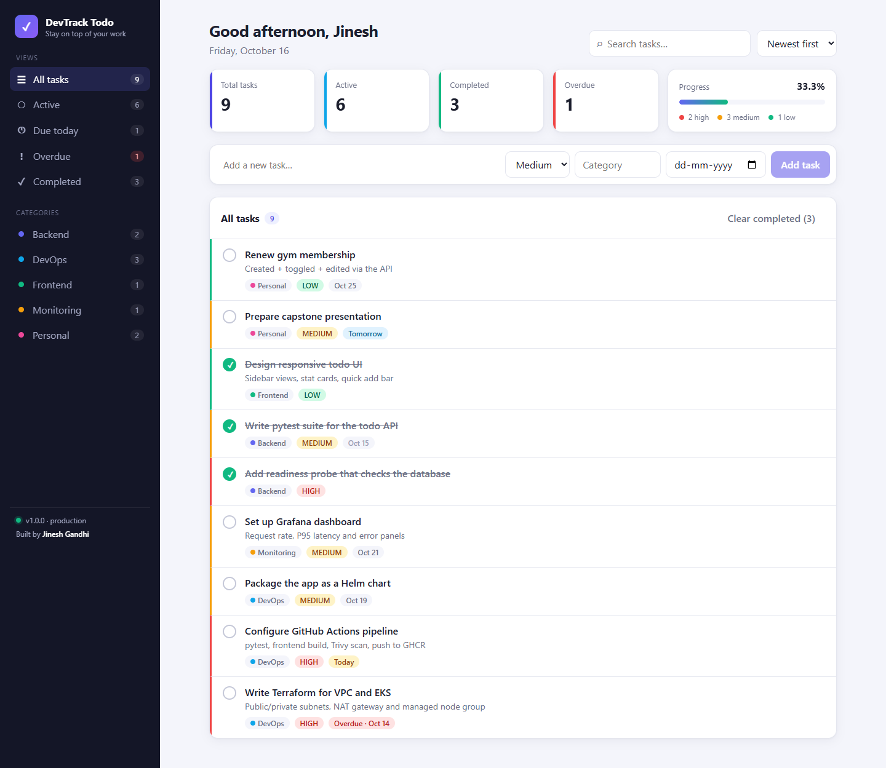

# DevTrack Todo ✅
> **A full-stack todo application delivered through a complete DevOps pipeline — DevOps Capstone Project by Jinesh Gandhi**

[](https://github.com/jineshgandhi79/Devops-capstone/actions/workflows/ci.yml)
[](https://kubernetes.io/)
[](https://www.terraform.io/)
[](https://trivy.dev/)

DevTrack Todo is a 3-tier todo application (React + FastAPI + PostgreSQL) used to demonstrate how an application travels from a developer laptop to a monitored Kubernetes environment: automated tests, container builds, security scanning, a container registry, infrastructure as code on AWS, Helm-based deployment, GitOps, and observability with Prometheus and Grafana.

- **Author:** Jinesh Gandhi ([@jineshgandhi79](https://github.com/jineshgandhi79))
- **Repository:** https://github.com/jineshgandhi79/Devops-capstone



---

## 1. Features

**Application**
- Create, edit, complete and delete todos
- Priorities (High / Medium / Low), categories and due dates
- Smart views: All, Active, Due today, Overdue, Completed
- Category filter, case-insensitive search and sorting (newest, due date, priority, title)
- Dashboard cards: total, active, completed, overdue, completion progress and priority split
- "Clear completed" bulk action
- Responsive layout (desktop sidebar → mobile scrolling tabs), loading skeletons, empty and error states

**Operations**
- `/health` liveness probe and `/ready` readiness probe (readiness checks the database and returns `503` when it is unreachable)
- `/metrics` Prometheus endpoint with request counters and latency histograms
- Alembic migrations applied automatically when the backend container starts

---

## 2. Architecture

```
                                  Client Browser
                                        │
           ┌────────────────────────────┴────────────────────────────┐
           │                                                         │
   [Local Development]                                       [AWS Production]
   http://localhost:3000                           http://<AWS-NLB-DNS-Hostname>/
           │                                                         │
           ▼                                                         ▼
┌───────────────────────┐                                 ┌───────────────────────┐
│   devtrack-frontend   │                                 │   Ingress NGINX NLB   │
│ Nginx (static + /api  │                                 └───────────┬───────────┘
│   reverse proxy)      │                     ┌───────────────────────┴───────────────┐
└──────────┬────────────┘                     ▼ (Path: /)                             ▼ (Path: /api, /docs)
           │ /api                   ┌───────────────────┐                   ┌───────────────────┐
           ▼                        │ devtrack-frontend │                   │  devtrack-backend │
┌───────────────────────┐           │    (3 Replicas)   │                   │    (2 Replicas)   │
│   devtrack-backend    │           └───────────────────┘                   └─────────┬─────────┘
│    (FastAPI:8000)     │                                                             │
└──────────┬────────────┘◄────────────────────────────────────────────────────────────┘
           ▼
┌───────────────────────┐
│   PostgreSQL 16 DB    │
│  (Alembic Migrations) │
└───────────────────────┘
```

The browser only ever calls relative `/api/...` URLs. Nginx (Docker Compose), the Kubernetes Ingress, and the Vite dev server proxy all route `/api` to the backend, so no backend hostname is baked into the frontend build.

---

## 3. Technology Stack

| Layer | Technology | Purpose |
| :--- | :--- | :--- |
| **Frontend UI** | React 19, Vite, CSS | Todo dashboard, filters, quick-add, edit modal |
| **Frontend server** | Nginx (`nginx-unprivileged`) | Non-root static server on port 8080 + `/api` reverse proxy |
| **Backend API** | FastAPI, Pydantic v2, Uvicorn (Python 3.12) | REST API with validation and OpenAPI docs |
| **Database** | PostgreSQL 16 | Persistent storage for todos |
| **ORM & migrations** | SQLAlchemy 2, Alembic | Data access and versioned schema |
| **Tests** | Pytest (+ in-memory SQLite) | 28 automated API tests |
| **Containers** | Docker, Docker Compose | Reproducible local stack |
| **CI/CD** | GitHub Actions | Test → build → scan → push → GitOps deploy |
| **Security** | Trivy | HIGH/CRITICAL vulnerability and secret scanning |
| **Registry** | GitHub Container Registry | Commit-SHA tagged images |
| **Infrastructure** | Terraform on AWS | VPC, subnets, NAT, EKS, managed node group |
| **Kubernetes** | Amazon EKS, Helm, Ingress-NGINX, ArgoCD | Deployment, packaging, routing, GitOps |
| **Observability** | Prometheus, Grafana | Metrics scraping and dashboards |

---

## 4. REST API

| Method | Path | Description |
| :--- | :--- | :--- |
| `GET` | `/api/todos` | List todos. Query params: `status` (`all`, `active`, `completed`, `today`, `overdue`), `priority`, `category`, `search`, `sort` (`created`, `due_date`, `priority`, `title`) |
| `GET` | `/api/todos/stats` | Totals, overdue / due-today counts, completion rate, per-priority and per-category counts |
| `GET` | `/api/todos/{id}` | Get one todo |
| `POST` | `/api/todos` | Create a todo |
| `PUT` | `/api/todos/{id}` | Partially update a todo (any subset of fields) |
| `PATCH` | `/api/todos/{id}/toggle` | Toggle completed / active |
| `DELETE` | `/api/todos/{id}` | Delete a todo |
| `DELETE` | `/api/todos/completed` | Delete all completed todos |
| `GET` | `/api/info` | App name, version, environment |
| `GET` | `/health` · `/ready` · `/metrics` | Liveness, readiness, Prometheus metrics |

Interactive Swagger docs: `http://localhost:8000/docs`

Example:
```bash
curl -X POST http://localhost:8000/api/todos \
  -H 'Content-Type: application/json' \
  -d '{"title":"Deploy to EKS","priority":"HIGH","category":"DevOps","due_date":"2026-10-30"}'
```

---

## 5. Run Locally (Docker Compose)

Prerequisites: Docker Engine 24+ with Docker Compose v2.

```bash
git clone https://github.com/jineshgandhi79/Devops-capstone.git
cd Devops-capstone
docker compose up --build -d
docker compose ps        # all three containers should be Up (healthy)
```

| URL | What |
| :--- | :--- |
| http://localhost:3000 | DevTrack Todo web app |
| http://localhost:8000/docs | Swagger / OpenAPI docs |
| http://localhost:8000/health | Liveness probe |
| http://localhost:8000/ready | Readiness probe (checks PostgreSQL) |
| http://localhost:8000/metrics | Prometheus metrics |

Stop: `docker compose down` · Stop and delete the database volume: `docker compose down -v`

### Run without Docker

```bash
# Backend (needs a PostgreSQL; defaults to localhost:5433 from docker compose)
cd backend
python -m venv .venv && source .venv/bin/activate
pip install -r requirements.txt
alembic upgrade head
uvicorn app.main:app --reload --port 8000

# Frontend (Vite proxies /api to localhost:8000)
cd frontend
npm ci
npm run dev        # http://localhost:5173
```

---

## 6. Testing

```bash
cd backend
pytest -v
```

**28 tests** cover CRUD, validation (blank/oversized titles, bad enums, bad dates), partial updates, toggling and `completed_at`, status/priority/category/search filters, sorting, stats, clear-completed, health/readiness (including a simulated database outage) and the metrics endpoint. Tests run against an isolated in-memory SQLite database; in CI the migrations are additionally applied to a real PostgreSQL service container.

---

## 7. CI/CD Pipeline (GitHub Actions)

Defined in [.github/workflows/ci.yml](.github/workflows/ci.yml):

```
push / PR to main
   │
   ├── backend-test      PostgreSQL service → alembic upgrade head + alembic check → pytest
   └── frontend-build    npm ci → oxlint → vite build
             │  (both must pass)
             ▼
   docker-build (matrix: backend, frontend)
       build image → Trivy scan (HIGH/CRITICAL, fails the job) → push to GHCR
       tags: <full commit SHA> and latest
             │  (main branch only)
             ▼
   deploy (GitOps)
       pin the new SHA in helm/devtrack/values.yaml → commit [skip ci]
       → ArgoCD syncs the cluster
```

Images:
- `ghcr.io/jineshgandhi79/devtrack-backend:<sha>`
- `ghcr.io/jineshgandhi79/devtrack-frontend:<sha>`

> After the first push, make both GHCR packages public (Package settings → Change visibility) or add an `imagePullSecret` so the cluster can pull them.

---

## 8. Infrastructure as Code (Terraform)

Under [`terraform/`](terraform/):
- Region `ap-southeast-2` (Sydney), VPC `10.0.0.0/16`
- 2 public subnets (`10.0.1.0/24`, `10.0.2.0/24`) with Internet Gateway and NAT Gateway
- 2 private subnets (`10.0.10.0/24`, `10.0.11.0/24`) for worker nodes
- EKS cluster `devtrack-eks-cluster` with a `t3.medium` managed node group and the EBS CSI add-on

```bash
cd terraform
terraform init
terraform plan
terraform apply
aws eks update-kubeconfig --region ap-southeast-2 --name devtrack-eks-cluster
# ... demo ...
terraform destroy     # avoid ongoing AWS charges
```

---

## 9. Kubernetes & Helm

Chart: [`helm/devtrack`](helm/devtrack)
- Namespace `devtrack`
- `devtrack-backend`: 2 replicas, rolling updates, `/health` liveness and `/ready` readiness probes
- `devtrack-frontend`: 3 replicas, unprivileged Nginx
- `devtrack-postgres`: PostgreSQL with a PersistentVolumeClaim (EBS gp2)
- Ingress (NGINX): `/` → frontend, `/api` and `/docs` → backend

```bash
helm upgrade --install devtrack helm/devtrack --namespace devtrack --create-namespace
kubectl get pods,svc,ingress -n devtrack
helm list -n devtrack
```

GitOps with ArgoCD: `kubectl apply -f argocd/application.yaml -f argocd/monitoring-application.yaml` (tracks `helm/devtrack` and `monitoring/` on `main`). Every green CI run commits a new image SHA to `values.yaml`, and ArgoCD rolls the cluster forward automatically.

### Autoscaling (HPA)

The backend has a HorizontalPodAutoscaler (2–6 replicas, 60 % CPU target, 2-minute scale-down window). It needs [metrics-server](https://github.com/kubernetes-sigs/metrics-server).

```bash
kubectl apply -f scripts/hpa-load-test.yaml      # 4 in-cluster load generators
kubectl get hpa -n devtrack -w                   # watch replicas climb to 6
kubectl delete -f scripts/hpa-load-test.yaml     # scale back down after ~2 minutes
```

### Local cluster (kind)

The Kubernetes screenshots were taken on a 3-node [kind](https://kind.sigs.k8s.io/) cluster with ingress-nginx, metrics-server and ArgoCD 2.13. Because the chart requests the AWS `gp2` storage class, the kind cluster gets a `gp2` StorageClass backed by kind's `rancher.io/local-path` provisioner, so the chart deploys unchanged.

---

## 10. Observability

- The backend exposes `devtrack_http_requests_total`, `devtrack_http_request_duration_seconds` and `devtrack_app_info` at `/metrics`, labelled by route template (e.g. `/api/todos/{todo_id}`) to keep cardinality low.
- Prometheus ([`monitoring/`](monitoring/)) scrapes `devtrack-backend.devtrack.svc.cluster.local:8000/metrics` every 15 s.
- Grafana ships a provisioned dashboard: availability, request totals and rate, P95/P99 latency, 5xx error rate, memory and CPU.

```bash
kubectl port-forward -n monitoring svc/prometheus 9090:9090
kubectl port-forward -n monitoring svc/grafana 3001:3000
```

---

## 11. Project Structure

```
Devops-capstone/
├── frontend/              React + Vite app, Nginx config, Dockerfile
├── backend/               FastAPI app, Alembic migrations, pytest suite, Dockerfile
├── docker-compose.yml     Local 3-container stack
├── .github/workflows/     CI/CD pipeline
├── terraform/             AWS VPC + EKS
├── helm/devtrack/         Helm chart
├── k8s/                   Plain Kubernetes manifests (Kustomize)
├── argocd/                ArgoCD Application definitions
├── monitoring/            Prometheus + Grafana manifests
└── demo/                  Screenshots and presentation
```

---

## 12. Evidence & Presentation

- Presentation: [demo/ppt/presentation.pptx](demo/ppt/presentation.pptx)
- Screenshots: [demo/screenshots/](demo/screenshots/)

| Screenshot | Shows |
| :--- | :--- |
| [M1-application-dashboard.png](demo/screenshots/M1-application-dashboard.png) | Todo dashboard with stats, views and categories |
| [M1-application-edit-modal.png](demo/screenshots/M1-application-edit-modal.png) | Edit task dialog |
| [M1-application-category-filter.png](demo/screenshots/M1-application-category-filter.png) | Category filter |
| [M1-application-mobile.png](demo/screenshots/M1-application-mobile.png) | Responsive mobile layout |
| [M2-pytest-passing.png](demo/screenshots/M2-pytest-passing.png) | 28 passing pytest tests |
| [M4-docker-compose-running.png](demo/screenshots/M4-docker-compose-running.png) | Docker Compose stack healthy, migration applied |
| [M4-postgres-todos-table.png](demo/screenshots/M4-postgres-todos-table.png) | `todos` table in PostgreSQL |
| [M4-health-readiness-api.png](demo/screenshots/M4-health-readiness-api.png) | Health, readiness and stats API responses |
| [M6-trivy-scan.png](demo/screenshots/M6-trivy-scan.png) | Trivy scan: 0 HIGH / 0 CRITICAL in both images |
| [M8-swagger-docs.png](demo/screenshots/M8-swagger-docs.png) | Swagger API documentation |
| [M9-backend-metrics.png](demo/screenshots/M9-backend-metrics.png) | Prometheus metrics exposed by the backend |
| [M3-github-commit-history.png](demo/screenshots/M3-github-commit-history.png) | Commit history, including the bot's GitOps image-pin commits |
| [M5-github-actions-success.png](demo/screenshots/M5-github-actions-success.png) | Green GitHub Actions run (all 5 jobs) |
| [M5-github-actions-history.png](demo/screenshots/M5-github-actions-history.png) | Workflow run history |
| [M5-ghcr-packages.png](demo/screenshots/M5-ghcr-packages.png) · [M5-ghcr-backend-package.png](demo/screenshots/M5-ghcr-backend-package.png) | GHCR images tagged with commit SHAs |
| [M7-terraform-validate.png](demo/screenshots/M7-terraform-validate.png) | `terraform init`, `fmt -check` and `validate` |
| [M8-kubernetes-pods.png](demo/screenshots/M8-kubernetes-pods.png) | Nodes and pods (0 restarts) |
| [M8-kubernetes-services.png](demo/screenshots/M8-kubernetes-services.png) | Services, Ingress, PVC and endpoints |
| [M8-helm-release.png](demo/screenshots/M8-helm-release.png) | Helm release, history and deployed image SHAs |
| [M8-ingress-application.png](demo/screenshots/M8-ingress-application.png) | App served through the Ingress |
| [M9-prometheus-targets.png](demo/screenshots/M9-prometheus-targets.png) | Prometheus targets UP |
| [M9-prometheus-query.png](demo/screenshots/M9-prometheus-query.png) | Request rate per endpoint in Prometheus |
| [M9-grafana-dashboard.png](demo/screenshots/M9-grafana-dashboard.png) | Grafana dashboard with live traffic |
| [M10-troubleshooting-imagepullbackoff.png](demo/screenshots/M10-troubleshooting-imagepullbackoff.png) | Drill 1: ImagePullBackOff diagnosed and fixed |
| [M10-troubleshooting-service-selector.png](demo/screenshots/M10-troubleshooting-service-selector.png) | Drill 2: Service selector mismatch diagnosed and fixed |

| [M8-argocd-applications.png](demo/screenshots/M8-argocd-applications.png) | ArgoCD: app and monitoring synced from this repository |
| [M8-argocd-devtrack-tree.png](demo/screenshots/M8-argocd-devtrack-tree.png) | ArgoCD resource tree, synced to the bot's image-pin commit |
| [M8-hpa-scaling.png](demo/screenshots/M8-hpa-scaling.png) | HPA scaling the backend from 2 to 6 replicas under load, then back down |

> The Kubernetes, Helm, ArgoCD, HPA, Ingress, Prometheus and Grafana screenshots come from a local 3-node kind cluster that pulls the CI-built images from GHCR (see *Local cluster (kind)* above).
